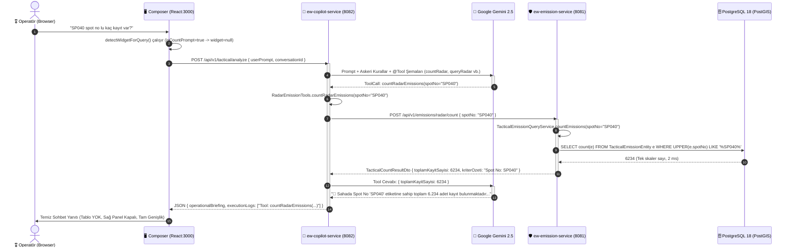

# 🛡️ Taktik Elektronik Harp (EH / C2) Sistemi: Çift Mikroservis, Spring AI ve Taktik Konsol Mimari Akış Dokümanı

**Doküman Versiyonu:** 3.0.0 (Kurumsal Çift Mikroservis & Taktik Doktrin Tam Sürüm)  
**Tarih:** 2026-10-20  
**Hedef Kitle:** Yazılım Mimarları, Sistem Mühendisleri, Elektronik Harp ve C2 Karar Destek Geliştiricileri  

---

## 1. YÖNETİCİ ÖZETİ VE MİMARİ VİZYON

Bu doküman; **Taktik Elektronik Harp (EH / SIGINT / C2)** harekât sahasında görev yapan karar vericiler ve operatörler için geliştirilmiş olan **yapay zekâ tabanlı sorgulama, karar destek ve durumsal farkındalık platformunun** çift mikroservis ve mikro-frontend (Composer) mimarisini, veri akışını ve Spring AI orkestrasyonunu en ince teknik ayrıntısına kadar açıklar.

Sistem, geleneksel monolitik yapay zekâ uygulamalarının getirdiği performans darboğazlarını, veri şişkinliğini ve coupling (sıkı bağlılık) problemlerini aşmak amacıyla **iki bağımsız mikroservis** ve **merkezi bir Taktik Komutan Konsolu (Composer Frontend)** olarak yeniden yapılandırılmıştır:

```text
┌────────────────────────────────────────────────────────────────────────────────────────┐
│                        MERKEZİ TAKTİK OPERATÖR KONSOLU (COMPOSER)                      │
│                               React 18 + Vite (Port 3000)                              │
│                                                                                        │
│   ┌─────────────────────┐   ┌─────────────────────┐   ┌────────────────────────────┐   │
│   │ 🧠 AI Taktik Copilot│   │ 📡 Radar (ELINT)    │   │ 📻 Muhabere (COMINT)       │   │
│   │    Chat & Widget    │   │    Sanal Tablo      │   │    Sanal Tablo             │   │
│   └──────────┬──────────┘   └──────────┬──────────┘   └─────────────┬──────────────┘   │
└──────────────┼─────────────────────────┼────────────────────────────┼──────────────────┘
               │                         │                            │
    REST / JSON│                         │REST / JSON                 │REST / JSON
    Port 8082  │                         │Port 8081                   │Port 8081
               ▼                         ▼                            ▼
┌──────────────────────────────┐       ┌─────────────────────────────────────────────────┐
│     ew-copilot-service       │       │               ew-emission-service               │
│         (Port 8082)          │       │                   (Port 8081)                   │
│                              │       │                                                 │
│ 🤖 Spring AI 1.x             │       │ 🛡️ PostgreSQL 18 + PostGIS Veri Deposu          │
│ 🧠 Google Gemini AI Engine   │  REST │ ⚡ 1.170.000+ Radar, 1.170.000+ COMINT Kaydı     │
│ 🛠️ @Tool Fonksiyonları       ├──────>│ 🔍 JPA Specification & Dinamik Criteria API     │
│ 🎯 Skaler / Liste Niyetleri  │       │ 📊 SQL COUNT(*) ve Agregasyon Motoru            │
│ 💬 Chat Memory (Oturum)      │       │ 📈 Korelasyon, Dalga Formu ve Dağılım Servisleri│
└──────────────────────────────┘       └─────────────────────────────────────────────────┘
```

---

## 2. SERVİS SINIRLARI VE SORUMLULUK MATRİSİ (BOUNDED CONTEXTS)

Sistem Domain-Driven Design (DDD) ilkeleri doğrultusunda iki ana bağlama (Bounded Context) ayrılmıştır:

| Boyut / Yetkinlik | `ew-emission-service` (Veri Servisi) | `ew-copilot-service` (AI Karar Destek) | `frontend` (Taktik Konsol) |
| :--- | :--- | :--- | :--- |
| **Rol & Amaç** | Ham telemetri ve feda edilemez taktik verinin kalıcılığı, indekslenmesi, PostGIS geometrisi ve hızlı sorgulanması. | Doğal dil girdisini anlama, askeri doktrine göre niyet sınıflandırma, @Tool çağrıları üretme ve taktik brifing sentezleme. | Operatöre yüksek kontrastlı askeri koyu tema (MIL-Dark), sekmeli gezinme, canlı grafikler ve sohbet arayüzü sunma. |
| **Çalışma Portu** | `http://localhost:8081` | `http://localhost:8082` | `http://localhost:3000` |
| **Temel Teknolojiler** | Spring Boot 3.3+, Spring Data JPA, Hibernate 6, PostgreSQL 18, PostGIS, HikariCP. | Spring Boot 3.3+, Spring AI 1.x, Google Gemini (Flash-Lite / Pro), RestClient. | React 18, Vite, Ant Design 5 (Dark Mode), Apache ECharts, Axios. |
| **Veritabanı Erişimi** | Doğrudan (Okuma/Yazma) - 2.3+ Milyon Kayıt. | **YOK** (Tamamen Stateless, Veri Servisi DTO'ları üzerinden REST ile haberleşir). | **YOK** (Vite Proxy üzerinden ilgili mikroservis uçlarına yönlenir). |
| **Kritik Endpoint'ler** | `/api/v1/emissions/radar/query`<br>`/api/v1/emissions/radar/count`<br>`/api/v1/emissions/comint/query`<br>`/api/v1/emissions/comint/count`<br>`/api/v1/tactical/*` | `/api/v1/tactical/analyze`<br>`/api/v1/tactical/reset-session` | `/` (Composer Ana Kabuğu)<br>Taktik Sohbet / Tablolar / Harita Görünümleri |

---

## 3. BACKEND MİMARİSİ VE SERVİSLER ARASI VERİ AKIŞI

### 3.1. `ew-emission-service` (Yayın ve Veri Servisi) Mimarisi

`ew-emission-service`, harekât sahasında konuşlu yerel algılayıcılardan (KORAL, REDET vb.) ve harici taktik veri linklerinden (Link-16, Link-22, JREAP) akan telemetriyi yönetir.

```text
ew-emission-service
├── web/
│   ├── EmissionQueryController.java     <-- AI Copilot @Tool REST uçları (/radar/query, /radar/count vb.)
│   ├── TacticalController.java          <-- UI Tabloları için sayfalı REST uçları (/api/v1/tactical/emissions)
│   └── TacticalAnalysisController.java  <-- Makro analiz, korelasyon ve dağılım uçları
├── service/
│   ├── TacticalEmissionQueryService.java<-- Radar JPA Criteria Builder, sayfalama ve count motoru
│   ├── TacticalComintQueryService.java  <-- Muhabere JPA Criteria Builder ve çağrı analizi
│   ├── RadarCorrelationService.java     <-- 1-to-N benzerlik, eşleşme ve RF zarfı IoU hesaplayıcı
│   ├── TacticalDistributionService.java <-- Pasta/Donut dağılım agregasyonları
│   └── TacticalWaveformTimelineService.java <-- Frekans, PRI, PW zaman serisi dalga formu motoru
└── infrastructure/
    ├── entity/TacticalEmissionEntity.java<-- PostGIS ST_Point / ST_Polygon elips geometrisi
    ├── entity/TacticalComintEntity.java  <-- Telsiz frekans, modülasyon ve çağrı kayıtları
    └── repository/                      <-- JpaSpecificationExecutor genişletmeli indeksli repolar
```

#### İndeksleme ve Performans Güvencesi:
- **Radar Tablosu:** `idx_emi_spot_no`, `idx_emi_teshis`, `idx_emi_radar_adi`, `idx_emi_freq_range`, `idx_emi_son_tespit_zamani`, `idx_emi_kayit_tipi`.
- **PostGIS GiST İndeksi:** Kestirim elipsleri ve yön kerteriz (LOB) çizgileri üzerinde mikro-saniye düzeyinde `ST_DWithin` ve mekânsal kesişim sorgusu sağlar.
- **Skaler Sayım Başarımı:** `countEmissions` metodu entity yüklemesi veya DTO dönüşümü yapmaksızın doğrudan JPA `emissionRepo.count(spec)` çalıştırarak **2.3 milyondan fazla kayıt üzerinde 1-4 milisaniye** içinde cevap üretir.

---

### 3.2. `ew-copilot-service` (Spring AI Bilişsel Muhakeme Servisi) Mimarisi

`ew-copilot-service`, operatörün doğal dil sorgusunu karşılayan, askeri terminolojiyi çözümleyen ve arkadaki veri servisini orkestre eden yapay zekâ beynidir.

```text
ew-copilot-service
├── client/
│   └── EmissionRestClient.java          <-- ew-emission-service'e giden HTTP REST istemcisi
├── tools/
│   ├── RadarEmissionTools.java          <-- @Tool queryRadarEmissions, countRadarEmissions, hierarchy vb.
│   └── ComintEmissionTools.java         <-- @Tool queryComintEmissions, countComintEmissions, callsign vb.
├── dto/
│   ├── TacticalCountResultDto.java      <-- Net sayım sonucu (toplamKayitSayisi, kriter, aciklama)
│   ├── TacticalQueryResult.java         <-- Liste sonucu (kayitlar, toplamKayitSayisi, sekme, not)
│   ├── RadarFilterQueryDto.java         <-- Veri servisi filtre payload'ı
│   └── ComintFilterQueryDto.java        <-- Muhabere filtre payload'ı
└── service/
    └── TacticalAgentService.java        <-- Spring AI ChatClient, Prompt Şablonları & Call Log Drenajı
```

#### Spring AI Fluent ChatClient ve Tool Entegrasyonu:
`TacticalAgentService`, Spring AI'ın `ChatClient.Builder` yapısını kullanarak çalışır:
```java
ChatResponse response = chatClient.prompt()
    .system(buildSystemPrompt()) // Askeri EH doktrini, niyet ayrımı kuralları
    .user(userPrompt)            // Operatörün doğal dildeki taktik sorusu
    .advisors(new MessageChatMemoryAdvisor(chatMemory, conversationId, 10))
    .tools(radarTools, comintTools) // Spring AI @Tool metotları Gemini'ye JSON-Schema olarak iletilir
    .call()
    .chatResponse();
```

---

## 4. DETAYLI UÇTAN UCA ÇALIŞMA AKIŞI (SEQUENCE DIAGRAM)

Aşağıdaki diyagram, operatörün *"SP040 spot no'lu kaç kayıt var?"* veya *"Düşman radarlarını listele"* sorgusu yaptığında iki mikroservis arasındaki tam etkileşimi gösterir:



---

## 5. SKALER SAYIM (COUNT) VE LİSTELEME (LIST) NİYET AYRIMI MANTIĞI

Askeri karar destek sistemlerinde en sık yapılan hata; kullanıcının sadece tek bir sayı istediği durumda ekrana devasa tablolar yığarak operatörün karar alma hızını yavaşlatmaktır.

Sistemde bu problem **üç katmanlı bir savunma hattıyla** çözülmüştür:

```text
┌────────────────────────────────────────────────────────────────────────────────────────┐
│                        KULLANICI SORGUSU: "SP040 kaç kayıt var?"                       │
└──────────────────────────────────────────┬─────────────────────────────────────────────┘
                                           │
                                           ▼
┌────────────────────────────────────────────────────────────────────────────────────────┐
│ KATMAN 1: FRONTEND REGEX VE NİYET TESPİTİ (CopilotChat.jsx)                             │
│ - isCountPrompt = true (ka[çc]|adet|sayı kelimeleri var, görsel anahtar yok)          │
│ - Karar: SAĞ PANELİ AÇMA (activeWidget = null), EKRANI TAM GENİŞLİKTE TUT              │
└──────────────────────────────────────────┬─────────────────────────────────────────────┘
                                           │
                                           ▼
┌────────────────────────────────────────────────────────────────────────────────────────┐
│ KATMAN 2: LLM AJAN YÖNERGESİ VE FUNCTION CALLING (TacticalAgentService.java)           │
│ - Kural: Sayım/Adet sorularında queryRadarEmissions DEĞİL, countRadarEmissions çağır!  │
│ - Kural: Asla Markdown tablosu üretme, tek cümlelik KPI brifingi ver!                  │
└──────────────────────────────────────────┬─────────────────────────────────────────────┘
                                           │
                                           ▼
┌────────────────────────────────────────────────────────────────────────────────────────┐
│ KATMAN 3: VERİ SERVİSİ VE VERİTABANI İNTİFASI (TacticalEmissionQueryService.java)       │
│ - emissionRepo.count(spec) çalışır. Liste çekilmez, DTO nesnesi üretilmez.             │
│ - 6234 sayısı hafif TacticalCountResultDto ile döner.                                  │
└────────────────────────────────────────────────────────────────────────────────────────┘
```

### Karşılaştırmalı Niyet Davranış Tablosu:

| Kullanıcı İfadesi | Hedef Niyet | Çağrılan Tool | Dönen DTO Tipi | Üretilen UI Çıktısı | Sağ Panel Widget'ı |
| :--- | :--- | :--- | :--- | :--- | :--- |
| *"SP040 spot no'lu kaç kayıt var?"* | **Skaler Sayım** | `countRadarEmissions` | `TacticalCountResultDto` | Tek satır durum kartı: *"🎯 Sahada Spot No 'SP040' etiketine sahip toplam 6.234 kayıt bulunmaktadır."* | **KAPALI (null)** |
| *"SP040 spot no'lu kayıtları listele"* | **Detay Listeleme** | `queryRadarEmissions` | `TacticalQueryResult` | Formatlı Markdown Tablosu + Üst Sekme Yönlendirme Notu | **KAPALI (null)** |
| *"SP048 dalga formu zamansal değişimini göster"* | **Görselleştirme** | `getTacticalWaveformTimeline` | `TacticalWaveformTimelineDto` | E-posta/Brifing Özeti + ECharts Zamansal Dalga Formu | **AÇIK (`WAVEFORM_TIMELINE`)** |
| *"Kriptolu kaç adet telsiz yayını var?"* | **Skaler Sayım** | `countComintEmissions` | `TacticalCountResultDto` | *"🎯 Sahada tespit edilen kriptolu muhabere yayını sayısı: 412.300"* | **KAPALI (null)** |
| *"Haftalık LOB dağılım grafiğini aç"* | **Görselleştirme** | `getWeekdayEmissionDistribution`| `WeekdayRadarDistributionDto` | Gün bazlı taktik brifing + ECharts Radar Örümcek Ağı | **AÇIK (`WEEKDAY_RADAR`)** |

---

## 6. FRONTEND MİMARİSİ VE COMPOSER SEKME DÜZENİ

Merkezi konsol (`frontend`), operatörün farklı taktik panellere tek tıkla ulaşmasını sağlayan bir **Composer** kabuğudur:

```text
frontend/src/
├── App.jsx                     <-- Ana Composer Menü ve Sekme Yöneticisi (MIL-Dark Shell)
├── components/
│   ├── CopilotChat.jsx         <-- Bilişsel Yapay Zeka Sohbet Arayüzü & Widget Algılayıcı
│   ├── RadarTable.jsx          <-- 1.17M Radar Kaydı için Yüksek Başarımlı Sanal Tablo
│   ├── ComintTable.jsx         <-- 1.17M Muhabere Kaydı için Sanal Tablo & Çağrı Analizi
│   ├── TacticalMap.jsx         <-- PostGIS Elips & LOB Görselleştirme Haritası
│   └── widgets/
│       ├── WaveformTimelineWidget.jsx  <-- RF Frekans/PRI/PW Değişim Çizelgesi (ECharts)
│       ├── CallsignHeatmapWidget.jsx   <-- Telsiz Çağrı Çiftleri Etkileşim Isı Haritası
│       ├── TacticalPieWidget.jsx       <-- Taktik Dağılım Donut/Pasta Grafiği
│       ├── SpectrumOccupancyWidget.jsx <-- NATO Frekans Bandı Spektrum Doluluk Çizelgesi
│       └── WeekdayRadarWidget.jsx      <-- 7 Günlük Aktivite Örümcek Ağı (Spider Web)
```

### Vite API Proxy Yapılandırması ([`vite.config.js`](file:///c:/Users/onderproje/Desktop/AntigravitySpringAIDeneme4/frontend/vite.config.js)):
Frontend tek bir domain üzerinden servis edilirken aradaki yönlendirmeyi Vite proxy şeffafça çözer:
- `/api/v1/tactical/analyze` & `/api/v1/tactical/reset-session` -> `http://localhost:8082` (`ew-copilot-service`)
- `/api/v1/tactical/emissions*` & `/api/v1/emissions/*` -> `http://localhost:8081` (`ew-emission-service`)

---

## 7. HATA TOLERANSI VE DAYANIKLILIK (RESILIENCE)

1. **Servis İzolasyonu:** `ew-copilot-service` kapalı olsa veya Gemini API kotası aşılsa bile operatör arayüzdeki Radar ve COMINT tablolarını doğrudan `ew-emission-service` üzerinden sıfır kesintiyle incelemeye ve filtrelemeye devam edebilir.
2. **REST İstemci Geri Çekilme (Fallback):** `EmissionRestClient` içinde her REST çağrısı `try-catch` bloklarıyla korunur. Veri servisi geçici olarak yanıt veremezse `TacticalCountResultDto(0L, "Hata", "Veri servisine erişilemedi")` dönerek yapay zekanın çökmesi engellenir.
3. **Veri Bütünlüğü ve Kalıcılık:** Her iki servisin yeniden başlatılması PostgreSQL'deki 2.3+ milyon hazır üretilmiş taktik kaydı kesinlikle silmez (`DataInitializer` kalıcılık kontrolü ile veriyi korur).

---

## 8. SONUÇ

Bu çift mikroservis mimarisi; yapay zekâ mantığını (`ew-copilot-service`), yüksek hacimli taktik telemetri veri ambarından (`ew-emission-service`) ve kullanıcı deneyiminden (`frontend`) tamamen izole etmiştir. Sayım sorularına özel geliştirilen hafif `count*` araçları ve frontend filtreleme mekanizması sayesinde sistem, askeri standartlarda deterministik, doğru ve görsel gürültüden arındırılmış bir C2 karar destek yeteneği kazanmıştır.
